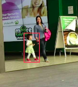
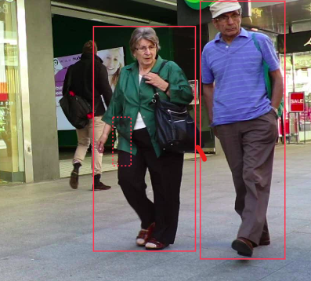
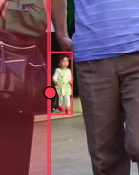

# Báo cáo cá nhân — NguyenQuocThang-2A202603158

Đoạn video: MOT17-09, 150 frame (frame 1–150), nguồn MOTChallenge, giấy phép CC BY-NC-SA 3.0.

> Số frame trong báo cáo ghi **theo CVAT (0–149)**. Trong `gt.txt`, `frame_id` = frame CVAT + 1.

## 0. Thông tin học viên

- Họ tên: Nguyễn Quốc Thắng
- MSSV: 2A202603158
- Mã đề (A/B/C): A — 5 người mục tiêu là ID gốc MOT17-09 `[1, 7, 19, 20, 21]` → `P1`–`P5`
- Email: quocthang9112@gmail.com
- Link repository: https://github.com/QuocThangNguyen-091102/K5-L2A-DAY05-NguyenQuocThang-2A202603158-MOTTracking
- Giờ bắt đầu: 22:01 (13/11/2026, GMT+7)
- Giờ kết thúc: 23:16 (13/11/2026, GMT+7)

## 1. Xem trước đoạn video (CP0)

Ghi **trước khi vẽ**, mỗi người một dòng.

| Mã | Frame xuất hiện | Frame cuối thấy được | Rẽ / dừng / đổi tốc độ ở frame | Bị che ở frame | Ghi chú |
|---|---|---|---|---|---|
| P1 | 0 | 149 | Dừng 20–25 và 31–38; tăng tốc 57–65; dừng 72–76; quay ngược nhẹ 97–102; đứng gần như yên 103–149 | 27–55 (một phần) | Đàn ông áo len đen trong cửa hàng Vodafone, đi sang phải sau quầy. Bị anh áo khoác đen, khăn đỏ (không thuộc 5 người) đi ngang và vung tay trước kính che một phần |
| P2 | 60 | 149 | Đi sang phải 60–112, khựng 84–88; quay lại sang trái 122–149; box cao dần từ ~95 (đi lại gần kính) | 60–149 (một phần, sau kính và cột cửa) | Người trong Vodafone sát kính bên trái, sau đó là cô áo trắng phối cam đi ra phía cửa. Lúc đầu chỉ thấy một dải hẹp sau khung kính |
| P3 | 0 | 149 | Bước nhanh 16–21; gần như dừng 62–72; tăng tốc 76–87; lại gần camera nhanh 117–135 (box to lên rất nhanh); dừng 145–149 | Không | Bà lớn tuổi áo khoác xanh lá, túi đen. Đi từ phải về phía camera, sóng đôi với P4 từ frame 39 |
| P4 | 39 | 149 | Vào khung từ mép phải ở 39; đổi kích thước liên tục khi lại gần camera; đi nhanh hơn 125–131 | Không (bị mép phải ảnh cắt 39–66) | Ông đội mũ, áo polo xanh sọc. Đi cạnh P3, box cao từ ~480 lên ~960 px |
| P5 | 0 | 149 | Đi sang phải 0–41 rồi đứng yên 41–149 | 109–137, 144–149 (một phần) | Bé gái váy xanh nhạt ở lối vào Woolworths, cạnh mẹ (không thuộc 5 người). Bị P3 và P4 đi ngang che |

## 2. Keyframe và thời gian (CP1, CP4)

Số keyframe lấy từ kết quả `src/check_submission.py`.

| Mã | Số keyframe | Keyframe ở frame | Số frame có mặt | Keyframe / 100 frame | Thời gian (phút) | Chỗ khó |
|---|---|---|---|---|---|---|
| P1 | 44 | 0, 5, 10, 15, 20, 25, 27, 30, 32, 39, 40, 48, 50, 51, 56, 60, 62, 64, 65, 66, 71, 75, 76, 85, 90, 96, 98, 101, 102, 104, 109, 112, 115, 117, 118, 120, 122, 124, 129, 137, 138, 144, 146, 149 | 150 | 29.3 | | Nhìn qua kính, bị che 27–55, đi – dừng – đi nhiều lần |
| P2 | 26 | 60, 64, 69, 74, 79, 83, 85, 88, 89, 93, 95, 100, 105, 111, 116, 121, 126, 129, 131, 132, 135, 136, 138, 140, 145, 148 | 90 | 28.9 | | Chỉ thấy một phần sau kính lúc đầu, khó ước lượng box toàn thân |
| P3 | 37 | 0, 10, 15, 16, 21, 27, 31, 36, 42, 47, 52, 57, 62, 67, 71, 72, 74, 75, 77, 78, 81, 82, 83, 86, 87, 90, 95, 100, 105, 110, 117, 122, 127, 134, 140, 145, 148 | 150 | 24.7 | | Lại gần camera, box đổi kích thước nhanh 117–135; đổi tốc độ 62–87 |
| P4 | 26 | 39, 46, 53, 57, 61, 66, 72, 81, 87, 92, 97, 102, 106, 111, 112, 116, 117, 120, 124, 127, 132, 136, 140, 144, 147, 149 | 111 | 23.4 | | Bị mép ảnh cắt 39–66; đi sát P3 |
| P5 | 13 | 0, 5, 11, 16, 20, 25, 30, 36, 41, 106, 109, 138, 144 | 150 | 8.7 | | Bị P3, P4 che 109–149 |
| **Tổng** | **146** | | **651** | **22.4** | **75** | |

Keyframe / 100 frame của cả bài = tổng keyframe ÷ tổng số frame có mặt × 100 = 146 ÷ 651 × 100 ≈ **22.4**

Bạn đặt keyframe nhiều nhất ở người nào? Vì sao (người đó rẽ, dừng, lại gần camera hay bị che)?
Nhiều nhất ở **P1 (44 keyframe)**. P1 đi rồi dừng nhiều lần sau quầy (dừng 20–25, 31–38, 72–76, đứng gần yên 103–149), tăng tốc đột ngột 57–65, và bị che một phần suốt 27–55. Mỗi lần đổi tốc độ, nội suy tuyến tính đều cho box đi trước hoặc sau người. Mỗi lần bật hoặc tắt cờ `occluded` cũng tạo thêm một keyframe. P1 lại nhìn qua kính nên khó căn mép box, phải chỉnh nhiều lần. Ngược lại, P5 chỉ cần 13 keyframe vì đứng yên từ frame 41: nội suy đúng hoàn toàn khi người không di chuyển.

## 3. Đoạn bị che (CP2)

Người bị che: `P1`

| Mốc | Frame |
|---|---:|
| Bắt đầu bị che một phần (bật `occluded`) | 27 |
| Mất hẳn (bật `outside`) | Không có |
| Hiện lại (tắt `outside`) | Không có |
| Thấy rõ trở lại (tắt `occluded`) | 56 |

- Thời gian khuất hẳn: 0 frame = 0 giây. Đoạn bị che một phần kéo dài 27–55 = 29 frame ≈ 0,97 giây (frame 30–31 và 39 thấy rõ hơn nên tắt `occluded`).
- Quyết định: **giữ cùng ID**.
- Lý do (trả lời 3 câu: khuất bao lâu so với 60 frame, ngoại hình có khớp, chỗ hiện lại có đúng hướng và tốc độ):

1. **Khuất bao lâu:** P1 không khuất hẳn frame nào, vẫn thấy một phần đầu và thân qua kính. Toàn bộ đoạn bị che chỉ 29 frame, nhỏ hơn nhiều so với ngưỡng 60 frame. Vì vậy chỉ bật `occluded`, không bật `outside`, và vẫn giữ box toàn thân ước lượng (amodal).
2. **Ngoại hình:** trước và sau đoạn che vẫn là người đàn ông áo len đen, cùng dáng, cùng kích thước, đứng sau cùng một quầy trong Vodafone.
3. **Hướng và tốc độ:** ở frame 56, P1 xuất hiện rõ tại x ≈ 350, tiếp tục đi sang phải đúng hướng cũ (x ≈ 320 trước khi bị che), tốc độ khoảng 1,5–2 px/frame như trước. Không có người nào khác ở vị trí đó để nhầm.

Ảnh chụp màn hình (MOT17, MOTChallenge (Milan et al., 2016)):





## 4. Tự review ID (CP3)

Lượt 1 theo người (đi ngược từ frame 149 về 0 trên CVAT), lượt 2 theo cảnh (nhảy 10 frame). Ít nhất 3 dòng; không có lỗi thì ghi một dòng "đã kiểm hai lượt, không lỗi".

Loại lỗi dùng đúng một trong 7 mã: `id_switch`, `fragmentation`, `lost`, `merge`, `false_track`, `drift`, `flag`.

| Frame | Mã người | Loại lỗi | Mô tả một câu | Phát hiện ở lượt | Đã sửa? |
|---:|---|---|---|---|---|
| 40 | P1 | `drift` | Mép trái box nhảy từ x≈319 sang x≈346 và box hẹp lại trong 1 frame, tức là box bị co theo phần nhìn thấy thay vì giữ toàn thân | 1 | Chưa — cần kéo lại mép trái trên CVAT |
| 49–51 | P1 | `drift` | Mép trên box nhấp nhô 454 → 449 → 444 → 454 trong lúc bị che, box rung không theo người | 1 | Chưa — cần xóa keyframe thừa ở 50–51 |
| 84–88 | P2 | `drift` | Box giật lùi sang trái (x 285 → 270) rồi vọt lại sang phải trong 4 frame, trong khi người đi đều | 1 | Chưa — cần chỉnh keyframe 85 |
| 117 | P4 | `drift` | Mép trên box nhảy lên 28 px trong 1 frame (227 → 199), cao hơn đầu người | 2 | Chưa — cần chỉnh keyframe 117 |
| 30–31, 39 | P1 | `flag` | Cờ `occluded` tắt lắt nhắt giữa đoạn bị che 27–55 trong khi P1 vẫn bị che một phần | 1 | Chưa — cần xem lại từng frame |
| 120–149 | P2 | `flag` | P2 đã ra vùng cửa mở, thấy rõ toàn thân nhưng cờ `occluded` vẫn bật đến hết đoạn | 2 | Chưa — cần tắt `occluded` từ frame thấy rõ |

Tổng hợp số lỗi theo loại:

| `id_switch` | `fragmentation` | `lost` | `merge` | `false_track` | `drift` | `flag` |
|---:|---:|---:|---:|---:|---:|---:|
| 0 | 0 | 0 | 0 | 0 | 4 | 2 |

Lỗi nào chỉ lượt 2 (theo cảnh) mới thấy, lượt 1 (theo người) không thấy? Vì sao?

Hai lỗi: `drift` của P4 ở frame 117 và `flag` của P2 từ frame 120. Ở lượt 1, mỗi lần chỉ nhìn một người và đi từng frame, nên box P4 cao thêm vài chục px trông giống người đang ngẩng đầu, khó nhận ra. Ở lượt 2, P4 đi sóng đôi với P3: so cạnh nhau thì box P4 cao vọt hẳn so với P3 nên mới lộ lỗi. Tương tự, khi xem cả cảnh mới thấy P2 đã ra tới vùng cửa mở, thấy rõ như P3 và P4, mà box vẫn nét đứt `occluded`.

## 5. File xuất và kết quả tự kiểm (CP4)

| Kiểm tra | Kết quả |
|---|---|
| Tên file MOT 1.1 | `src/exports/NguyenQuocThang_mot.zip` |
| Tên file CVAT for video 1.1 | `src/exports/NguyenQuocThang_cvat_video.zip` |
| Số track ID khác nhau trong `gt/gt.txt` (phải là 5) | 5 |
| Frame `outside` không có dòng trong `gt.txt` (đúng / sai) | Không áp dụng: không người nào bị bật `outside` (P1 chỉ bị che một phần, cả 5 người không rời khung trước frame 149) |
| Job đã completed trên CVAT máy cá nhân | |

Dán phần tóm tắt in ra từ `src/check_submission.py`:

```text
Số frame in theo CVAT (bắt đầu từ 0). Trong gt.txt, frame_id = frame CVAT + 1.

=== File MOT 1.1: NguyenQuocThang_mot.zip ===
  Số track ID: 5   |   Tổng số box: 651
  [OK]        Đúng 5 track ID.

  Track | Frame có mặt | Số frame | Đoạn vắng (outside)
      1 |   0–149      |      150 | -
      2 |   0–149      |      150 | -
      3 |   0–149      |      150 | -
      4 |  39–149      |      111 | -
      5 |  60–149      |       90 | -


=== File CVAT for video 1.1: NguyenQuocThang_cvat_video.zip ===

  Track | Nhãn   | Frame thấy | Keyframe | KF/100 frame | Frame occluded | Lần bật outside
      0 | person |        150 |       44 |         29.3 |             26 |               0
              Track 0: keyframe ở frame [0, 5, 10, 15, 20, 25, 27, 30, 32, 39, 40, 48, 50, 51, 56, 60, 62, 64, 65, 66, 71, 75, 76, 85, 90, 96, 98, 101, 102, 104, 109, 112, 115, 117, 118, 120, 122, 124, 129, 137, 138, 144, 146, 149]
      1 | person |         90 |       26 |         28.9 |             90 |               0
              Track 1: keyframe ở frame [60, 64, 69, 74, 79, 83, 85, 88, 89, 93, 95, 100, 105, 111, 116, 121, 126, 129, 131, 132, 135, 136, 138, 140, 145, 148]
      2 | person |        150 |       37 |         24.7 |              0 |               0
              Track 2: keyframe ở frame [0, 10, 15, 16, 21, 27, 31, 36, 42, 47, 52, 57, 62, 67, 71, 72, 74, 75, 77, 78, 81, 82, 83, 86, 87, 90, 95, 100, 105, 110, 117, 122, 127, 134, 140, 145, 148]
      3 | person |          0 |        0 |          0.0 |              0 |               0
              Track 3: keyframe ở frame []
  [CẢNH BÁO]  Track 3 chỉ thấy 0 frame: có thể là shape rời (vẽ bằng Shape) hoặc track thừa.
      4 | person |        111 |       26 |         23.4 |              0 |               0
              Track 4: keyframe ở frame [39, 46, 53, 57, 61, 66, 72, 81, 87, 92, 97, 102, 106, 111, 112, 116, 117, 120, 124, 127, 132, 136, 140, 144, 147, 149]
      5 | person |        150 |       13 |          8.7 |             35 |               0
              Track 5: keyframe ở frame [0, 5, 11, 16, 20, 25, 30, 36, 41, 106, 109, 138, 144]

  Tổng: 146 keyframe / 651 frame có mặt = 22.4 keyframe / 100 frame
  [OK]        Đọc được 6 track từ annotations.xml.

=== Tóm tắt ===
  Lỗi: 0   |   Cảnh báo: 0

```

Đối chiếu track trong file CVAT for video với mã người: track 0 = P1, track 1 = P2, track 2 = P3, track 4 = P4, track 5 = P5.

Giải thích cảnh báo: track 3 là track rỗng, toàn bộ frame đều `outside` (vẽ nhầm, không thuộc 5 người). Track này không có dòng nào trong `gt.txt`, nên file MOT 1.1 vẫn đúng 5 track ID và không tạo `false_track`.

## 6. Ba câu kết

1. Nếu được gán lại, bạn sẽ đặt keyframe khác ở đâu? Vì sao?

   Mình sẽ bỏ thói quen đặt keyframe đều khoảng 5 frame một lần, nhất là ở P1 đoạn 103–149 khi P1 gần như đứng yên: nội suy giữa hai đầu đoạn đứng yên đã đúng nên keyframe ở giữa là thừa. Thay vào đó, mình dồn keyframe vào chỗ nội suy sai: ngay trước, trong và ngay sau đoạn che 27–56 của P1, chỗ P3 bắt đầu tăng tốc (khoảng 72–76), chỗ P3 và P4 lại gần camera, box to nhanh (117–135). Như vậy mật độ sẽ về gần mức 8–18 keyframe mỗi người của lớp, box ít rung hơn và đỡ tốn công.

2. Có chỗ nào bạn không chắc "cùng ID hay ID mới"? Bạn đã quyết định và ghi chú thế nào?

   Có, ở P2. Từ frame 60, P2 chỉ hiện một dải hẹp sau khung kính bên trái. Về sau, người ra tới vùng cửa mở là cô áo trắng phối cam. Lúc đầu mình không chắc đó là cùng một người. Mình quyết định **giữ một track** vì box di chuyển liên tục, không mất dấu frame nào, vị trí và kích thước thay đổi dần đều. Điểm xuất hiện cũng khớp với điểm đánh dấu P2 trong bảng nhận diện đề A (frame 61). Đoạn bị che sau kính được ghi chú bằng cờ `occluded`.

3. Một lỗi ID trong job của bạn (nếu không còn sót, chọn lỗi đã sửa) có thể làm xe tự lái dự đoán sai chuyển động của người đó như thế nào? Lỗi đó ảnh hưởng MOTA hay IDF1 nhiều hơn?

   File không có `id_switch`. Chỗ dễ đổi ID nhất là frame 109–120, khi P3 (bà áo xanh đi khoảng 7–16 px/frame) đi ngang ngay trước P5 (bé gái đứng yên). Hai box chồng lên nhau, nên nếu ghép theo khoảng cách tâm thì ID của hai người dễ bị tráo. Khi đó, vận tốc tính từ nhãn của bé gái sẽ nhảy từ 0 lên vài chục px chỉ trong một frame (1/30 s), như thể bé đột ngột lao ra. Ngược lại, bà P3 lại bị coi là đang đứng yên. Một hệ thống dự đoán chuyển động học từ nhãn này sẽ đoán bé gái sắp bước ra đường, dẫn tới phanh gấp, hoặc bỏ qua người đang thật sự đi tới gần. Lỗi này ảnh hưởng **IDF1 nhiều hơn MOTA**. MOTA chỉ trừ 1 lần IDSW tại frame tráo. IDF1 thì tính sai cho mọi frame sau đó, vì cả hai track đều bị gán sai danh tính đến hết đoạn.

## Bonus (nếu làm)

### B1 — Hai người đi sát

Không làm.

### B2 — So cách đặt keyframe

Không làm.

| Cách đặt | Số keyframe | Frame trôi nhất | Ghi chú |
|---|---:|---:|---|
| Đều mỗi 30 frame | | | |
| Theo chỗ đổi hướng | | | |

### B3 — So với tracker có sẵn

Không làm.

| Frame | Mã người | Tracker làm gì | Nhãn của bạn | Giải thích (đoán rồi sửa / ghép IoU / box score thấp / ngoại hình) |
|---:|---|---|---|---|
| | | | | |

## 7. Tài liệu tham khảo và công cụ AI đã dùng

- `docs/GUIDELINE.md`, `docs/CVAT_CHEATSHEET.md`, `docs/MOT_FORMAT.md`, `CHECKPOINTS.md`, `RUBRIC.md` của repo lab.
- Dữ liệu: MOT17-09, MOTChallenge (Milan et al., 2016), giấy phép CC BY-NC-SA 3.0.
- Công cụ: CVAT Community chạy local (Docker), `src/setup_local_lab.py`, `src/check_submission.py`.
- AI: Claude (Claude Code) hỗ trợ đọc file `annotations.xml` xuất từ CVAT, ước lượng vị trí keyframe, các đoạn `occluded`, tìm các chỗ box rung hoặc nhảy, và soạn nháp báo cáo. Mọi số liệu và lỗi đều đối chiếu lại trên CVAT.
